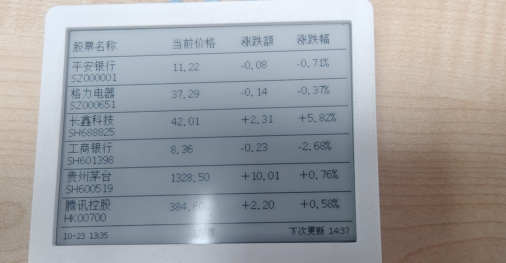
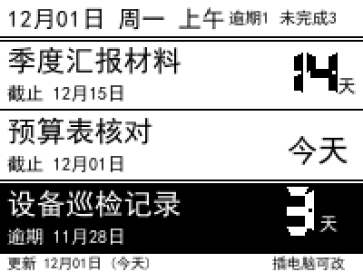
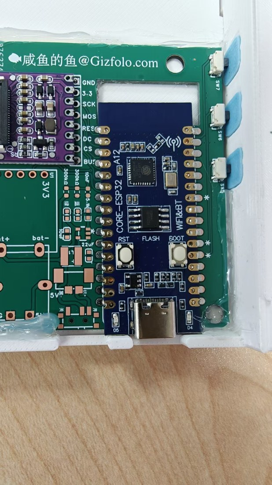
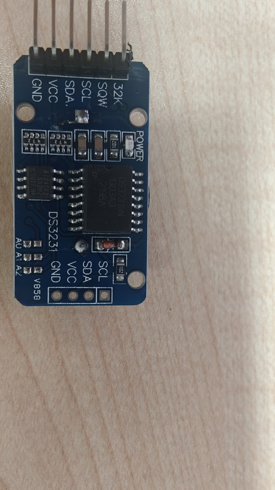

# deadline-board · 从炒股机到 Deadline 提示板

<p align="center">
  
  &nbsp;&nbsp;
  
</p>

<p align="center"><b>左边是它的一生前半段：桌面股票行情机。<br>右边是它的后半段：我办公桌上的工作 Deadline 提示板。</b></p>

---

## 这是什么

一块 **4.2 寸墨水屏**摆在办公桌上，只干一件事：**盯住最多 3 件在跑的活，告诉我每件还剩几天**。

- 到期越近数字越大，逾期直接**反白标黑**
- 底栏常驻「上次更新日期」，信息多旧一眼便知
- 断电画面不消失（墨水屏特性），插上电脑才能改——**这是特性，不是缺陷**，原因见下

它原本是一台某宝/某鱼上很常见的**桌面股票行情显示器**：播股票、播基金、播天气。卖家固件闭源，屏幕只能显示它给你安排的内容。这个项目把它彻底改造成了完全自定义的单任务终端。

## 为什么这么改造（三条硬约束）

这个项目不是"能做什么做什么"，而是被三个现实约束倒逼出来的设计：

| 约束 | 来源 | 由此产生的设计 |
|---|---|---|
| **办公区禁止设备连 WiFi、禁止发热点** | 单位信息安全规定 | 放弃一切无线方案，更新通道收敛为 **USB 有线 + 串口协议** |
| **一页只放 3 条，字要大** | 使用者老花眼 | 大字号 DSEG7 数码管字体，天数 56px 起步，逾期整行反白 |
| **断电不能丢时间** | 每次插拔 USB 后不想重新对时 | 外挂 **DS3231**（温补晶振 + 纽扣电池），断电走时钟 |

**墨水屏在这里是必然选择而非情怀**：一块天天只更新一两次的提示板，值得"不插电也一直显示"，也值得"不发光、不弹通知、不看它时完全隐身"。

## 拆解发现（这台股票机挺有意思）

撬开后盖，里面的东西比想象的有料：

<p align="center">
  
  &nbsp;&nbsp;
  
</p>

**1. PCB 丝印会骗人。** 板上印着 `ESP32-S3` / `CORE-S3`，我一开始真信了。`esptool` 直读芯片ID 才发现：**实际是 ESP32-C3**（单核 RISC-V，4MB Flash）。丝印是卖家自己打的板名，不是芯片型号——**别信丝印，信工具**。

**2. 屏幕藏着一个彩蛋。** 屏幕一直只显示黑白，我差点以为它是两色屏。读厂家驱动源码发现控制器是 **SSD1619，三色面板 GDEH042Z96（黑/白/红）**，再翻厂家 demo 字库，红色层数据真实存在——渲染出来是一幅"黑白树 + 红花"的测试图。也就是说：**红色强调能力是现成的，卖家固件根本没用**。本项目已把驱动切到三色模式，红色留给了"逾期"和强调场景。

**3. 它没有局部刷新。** 这块屏的全刷约 **4.2 秒**，且不支持局刷（一部分墨水屏支持只重画变化区域）。所以固件的策略是：**内容不常变，变了就整屏刷一次，刷完就静默**——反正一天也刷不了几回。

**4. 原生 USB，免驱动。** ESP32-C3 自带 USB-Serial/JTAG，插上就是串口，不需要 CH340/CP2102 转接。这让"插电脑改内容"的体验干净利落。

## 优点 / 缺点（玩家视角，说实话）

**优点**

- **二次改造底子好**：外壳、按键（3 个）、电池仓、屏都是现成的，主板就一颗 ESP32-C3，心智负担极低
- **USB 原生**，不用焊 USB-TTL，不用装驱动
- **三色屏的红色是免费赠品**，多数同价位股票机固件根本不开放
- **墨水屏 + DS3231**：断电后画面和时间都活着，作为"摆在那儿的信息板"几乎零维护
- 改造全程不需要动一根屏线，**所有工作都在主控侧**，可逆、不伤硬件

**缺点 / 坑**

- **无局刷**，全刷 4.2s，高频刷新场景（秒表、动画）直接出局
- **4MB Flash 且必须 DIO 模式烧录**，QIO 直接 bootloop，这个坑能耗掉一个晚上
- **串口打开前必须拉低 DTR/RTS**，否则 C3 进复位、什么都收不到——所有串口工具默认行为都跟你对着干
- 卖家固件闭源，原功能（WiFi 拉行情）拆掉后**没有回头的现成路径**，好在本来也不想要
- 三色模式比黑白多占 15KB 内存，且三色全刷比黑白更慢（本项目目前主用黑白，红色层待启用）

## 加了什么（改造清单）

| 改动 | 说明 |
|---|---|
| **DS3231 RTC** | SDA=GPIO1 / SCL=GPIO8，地址 0x68；区分「RTC 能读」与「时间可信」，不可信时屏显「未对时·插电脑」 |
| **串口文本协议** | `TIME` / `ITEM` / `CLR` / `STATUS` 等命令，见下表；TIME 六字段全验，缺一拒绝 |
| **DSEG7 数字字体** | 大天数用七段数码管字体（56px），自带数码管的复古味；字模全量打包进固件（SIL OFL 授权） |
| **工作日计算** | 内置 2026–2027 法定节假日表，倒数天数自动跳过周末和假期——「还剩 8 天」是真的 8 个工作日 |
| **逾期反白行** | 逾期的条目整行黑底白字，扫一眼就知道哪件事着火了 |
| **上午/下午心跳** | 页眉显示半天粒度的时间，证明设备活着 |
| **STATUS 自检** | 回读开机秒数、RTC 状态、当前条目，调试不用猜 |

## 快速上手

**硬件**：改造对象为 4.2 寸 Z96 股票行情机（ESP32-C3 + GDEH042Z96），DS3231 模块约 5 元。

**编译烧录**（arduino-cli）：

```
arduino-cli compile --fqbn "esp32:esp32:esp32c3:CDCOnBoot=cdc,FlashMode=dio,FlashFreq=80,FlashSize=4M,PartitionScheme=no_ota" .
arduino-cli upload  -p COM4 --fqbn "…" .
```

> ⚠️ FlashMode 必须 **dio**，QIO 会 bootloop。
> 依赖：U8g2、GxEPD2（驱动为 `GxEPD2_420c_Z96` 本地改版）。

**日常使用**（插 USB，一条命令改完拔走）：

```bash
python deadline_send.py "季度汇报材料|2026-12-15" "预算表核对|2026-12-01" "设备巡检记录|2026-11-28"
python deadline_send.py --status     # 看设备状态
python deadline_send.py --time       # 重新对时
```

**串口协议**（115200，先拉低 DTR/RTS）：

```
PING                          → OK
TIME|2026-12-01 09:00:00      → OK TIME（六字段全验，缺一拒绝）
ITEM|n|标题|2026-12-15        → OK ITEM n（标题≤10字）
CLR|n / CLEARALL / SHOW       → OK …
STATUS / RTC / DUMP           → 状态回读 / 整屏缓冲区导出
```

## 版本记录

- **v3.11**（2026-11-03）：「还要吗?」确认逻辑只盘逾期条目；内置 2027 法定节假日表；TIME 六字段全验
- v3.10：STATUS 增加 `up=`（开机秒数）
- v3.9：上午/下午心跳 + 串口链路加固
- v3.8：区分「RTC 能读」与「时间可信」
- v3.7：DSEG7 Bold 字模全量上屏
- v1.0–v3.6：引脚验证 → 三色驱动移植 → 版式三代演进 → 协议加固（共 12 版，详见 git 历史）

## License

代码 MIT；DSEG 字体 SIL OFL 1.1（见 `DSEG-LICENSE.txt`）。
